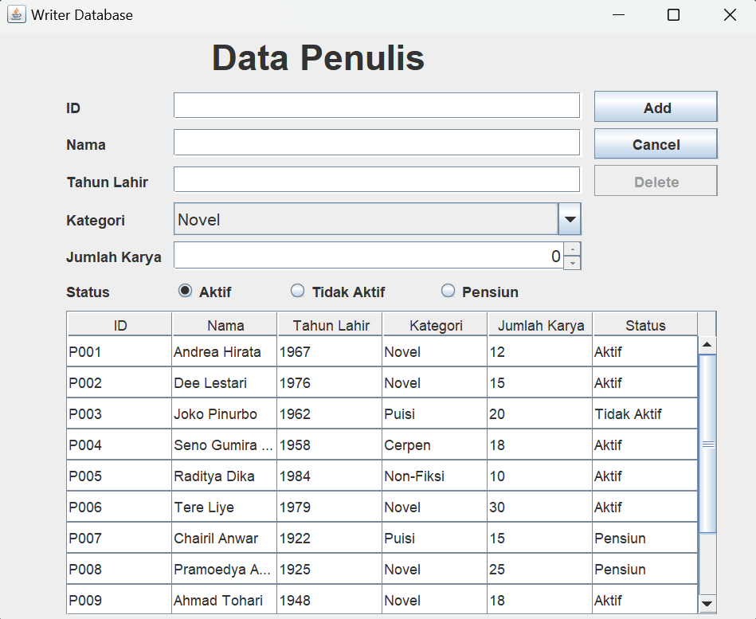
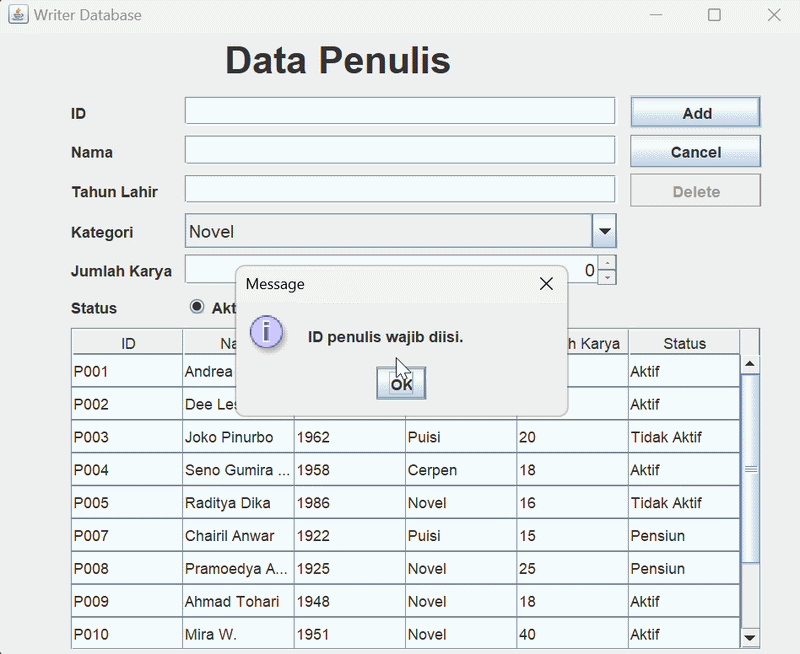

# Tugas Praktikum 4 DPBO

## Janji
Saya Ingrid Gabryella Nainggolan dengan NIM 2506442 mengerjakan TP 4 dalam mata kuliah Desain dan Pemrograman Berorientasi Objek untuk keberkahan-Nya maka saya tidak melakukan kecurangan seperti yang telah dispesifikasikan. Aamiin.

---

## Tujuan Program

Tujuan pembuatan aplikasi Writer Database adalah:

1. Mengimplementasikan operasi CRUD (*Create, Read, Update, Delete*).
2. Mempermudah pengelolaan data penulis melalui antarmuka grafis.
3. Menerapkan penggunaan kelas dan objek dalam Java.
4. Mengimplementasikan penyimpanan data sementara menggunakan `ArrayList`.
5. Menerapkan validasi input dan penanganan kesalahan (*error handling*) sesuai implementasi program.

## Teknologi yang Digunakan

- **Bahasa Pemrograman:** Java
- **GUI:** Java Swing
- **Struktur Data:** `ArrayList`
- **Komponen GUI:** `JPanel`, `JTextField`, `JSpinner`, `JComboBox`, `JRadioButton`, `JTable`, `JButton`, dan `JLabel`
- **IDE:** IntelliJ IDEA

## Desain Program

### 1. Desain Antarmuka

Antarmuka aplikasi terdiri atas formulir input data penulis, tombol operasi, dan tabel yang menampilkan data penulis.

Formulir digunakan untuk memasukkan atau mengubah informasi penulis, sedangkan tabel digunakan untuk menampilkan data yang tersedia.



### 2. Struktur Data Penulis


Setiap objek penulis memiliki atribut berikut:

| Atribut | Tipe Data | Deskripsi |
|---|---|---|
| `id` | `String` | Identitas penulis. |
| `nama` | `String` | Nama penulis. |
| `tahunlahir` | `int` | Tahun lahir penulis. |
| `kategori` | `String` | Kategori karya penulis. |
| `jumlahkarya` | `int` | Jumlah karya penulis. |
| `status` | `String` | Status penulis, misalnya Aktif, Tidak Aktif, atau Pensiun. |

### 3. Komponen Antarmuka

| Komponen | Fungsi |
|---|---|
| ID Field | Memasukkan identitas penulis. |
| Nama Field | Memasukkan nama penulis. |
| Tahun Spinner | Menentukan tahun lahir penulis. |
| Kategori ComboBox | Memilih kategori karya penulis. |
| Jumlah Karya Spinner | Menentukan jumlah karya penulis. |
| Status Radio Button | Memilih status penulis. |
| Tabel Data Penulis | Menampilkan data penulis. |
| Tombol Add | Menambahkan data penulis baru. |
| Tombol Update | Memperbarui data penulis yang dipilih. |
| Tombol Delete | Menghapus data penulis yang dipilih. |
| Tombol Cancel | Membatalkan atau mereset pengisian sesuai implementasi program. |

## Fitur Program

### 1. Create — Menambahkan Data

Fitur Create digunakan untuk menambahkan data penulis baru ke dalam daftar data.

Alur proses:

1. Pengguna mengisi formulir data penulis.
2. Pengguna menekan tombol **Add**.
3. Program memproses data yang dimasukkan.
4. Data penulis ditambahkan ke dalam `ArrayList`.
5. Tabel diperbarui untuk menampilkan data terbaru.

### 2. Read — Menampilkan Data

Fitur Read digunakan untuk menampilkan data penulis yang tersedia di dalam daftar data.

Alur proses:

1. Program mengambil data penulis dari `ArrayList`.
2. Data diproses untuk ditampilkan pada tabel.
3. Tabel menampilkan informasi penulis sesuai kolom yang tersedia.

### 3. Update — Memperbarui Data

Fitur Update digunakan untuk mengubah informasi penulis yang sudah tersedia.

Alur proses:

1. Pengguna memilih salah satu baris pada tabel.
2. Program menampilkan data penulis yang dipilih ke dalam formulir.
3. Pengguna mengubah informasi yang diperlukan.
4. Pengguna menekan tombol **Update**.
5. Program memperbarui data penulis.
6. Tabel diperbarui untuk menampilkan hasil perubahan.

### 4. Delete — Menghapus Data

Fitur Delete digunakan untuk menghapus data penulis dari daftar data.

Alur proses:

1. Pengguna memilih data penulis pada tabel.
2. Pengguna menekan tombol **Delete**.
3. Program menghapus data yang dipilih dari `ArrayList`.
4. Tabel diperbarui sehingga data yang dihapus tidak lagi ditampilkan.

## Penyimpanan Data

Aplikasi Writer Database menggunakan `ArrayList` sebagai media penyimpanan data selama aplikasi berjalan.

Dengan pendekatan ini, data dapat ditambahkan, ditampilkan, diperbarui, dan dihapus tanpa memerlukan koneksi ke database eksternal.

Data yang tersimpan di dalam `ArrayList` hanya berada di memori program. Oleh karena itu, perubahan data tidak otomatis tersimpan secara permanen setelah aplikasi ditutup.

## Alur Kerja Program

Secara umum, alur kerja aplikasi Writer Database adalah sebagai berikut:

1. Program dijalankan.
2. Antarmuka aplikasi ditampilkan.
3. Data awal penulis dimuat apabila telah didefinisikan dalam program.
4. Data penulis ditampilkan pada tabel.
5. Pengguna memilih operasi yang ingin dilakukan.
6. Program menjalankan operasi Create, Read, Update, atau Delete.
7. Tabel diperbarui sesuai perubahan data.
8. Pengguna dapat melanjutkan pengelolaan data selama aplikasi berjalan.


## Error Handling

Error handling digunakan untuk menangani kondisi ketika pengguna memberikan input yang tidak sesuai atau melakukan operasi yang tidak memenuhi persyaratan program.

Berikut adalah skenario pengujian yang dapat digunakan sesuai validasi yang benar-benar tersedia pada program.

| Skenario | Perilaku yang Diharapkan |
|---|---|
| Field wajib kosong | Program memberikan peringatan dan tidak menambahkan data yang tidak lengkap. |
| ID penulis duplikat | Program menolak ID yang sudah digunakan jika validasi ID unik diterapkan. |
| Input angka tidak valid | Program menangani input yang tidak sesuai dengan tipe data numerik apabila input tersebut memungkinkan. |
| Membatalkan penghapusan | Data tetap tersedia jika program menyediakan dialog konfirmasi dan pengguna membatalkan penghapusan. |


## Hasil Pengujian

Pengujian dilakukan untuk memastikan bahwa fitur pengelolaan data penulis berjalan sesuai fungsinya.

| No. | Fitur yang Diuji | Skenario Pengujian | Hasil yang Diharapkan |
|---|---|---|---|
| 1 | Read | Membuka aplikasi | Data penulis ditampilkan pada tabel. |
| 2 | Create | Menambahkan data penulis baru | Data baru muncul pada tabel. |
| 3 | Update | Mengubah data penulis yang dipilih | Informasi pada tabel berubah sesuai pembaruan. |
| 4 | Delete | Menghapus data penulis yang dipilih | Data yang dihapus tidak lagi muncul pada tabel. |
| 5 | Cancel | Menekan tombol Cancel | Formulir kembali sesuai perilaku tombol yang diterapkan. |
| 6 | Validasi field | Membiarkan field wajib kosong | Program memberikan peringatan dan menolak data yang tidak valid. |
| 7 | Validasi ID | Memasukkan ID yang sudah digunakan | Program menolak ID duplikat jika validasi tersebut diterapkan. |
| 8 | Validasi tahun lahir | Memasukkan tahun lahir yang tidak valid | Program menolak input sesuai aturan validasi yang diterapkan. |


## Struktur Dokumentasi Repository

Pastikan struktur folder dokumentasi sesuai dengan tautan yang digunakan dalam README.

```text
TP4/
├── PeopleData/
│   ├── Person.java
│   ├── PeopleMenu.java
│   └── PeopleMenu.form
├── Dokumentasi/
│   ├── tampilan-awal.png
│   ├── read_data.mp4
│   ├── add_data.mp4
│   ├── update_data.mp4
│   ├── hapus_data.mp4
│   ├── tombol_cancel.mp4
│   ├── data_wajib_isi.mp4
│   └── id_duplikat_tahun_valid.mp4
└── README.md
```

## Dokumentasi 
### 1. Read — Membaca Data

[Klik di sini untuk menonton video Read Data](Dokumentasi/read_data.mp4)

### 2. Create — Menambahkan Data

[Klik di sini untuk menonton video Add Data](Dokumentasi/add_data.mp4)

### 3. Update — Memperbarui Data

[Klik di sini untuk menonton video Update Data](Dokumentasi/update_data.mp4)

### 4. Delete — Menghapus Data

[Klik di sini untuk menonton video Delete Data](Dokumentasi/hapus_data.mp4)

### 5. Tombol Cancel

[Klik di sini untuk menonton video Cancel](Dokumentasi/tombol_cancel.mp4)

### 6. Error Handling — Data Wajib Diisi



### 7. Error Handling — ID Duplikat dan Tahun Lahir Tidak Valid

[Klik di sini untuk menonton video validasi ID dan tahun lahir](Dokumentasi/id_duplikat_tahun_valid.mp4)


